# 00 – Lab setup

## Microsoft 365 tenant

- **Plan:** Microsoft 365 Business Premium (30-day trial, 1 paid seat, 25 trial licences)
- **Tenant:** `MoalinITLab.onmicrosoft.com`
- **Why Business Premium:** it is the only Microsoft 365 business plan that includes **Intune** and **Entra ID P1** (Conditional Access), alongside Exchange Online and the Office apps.

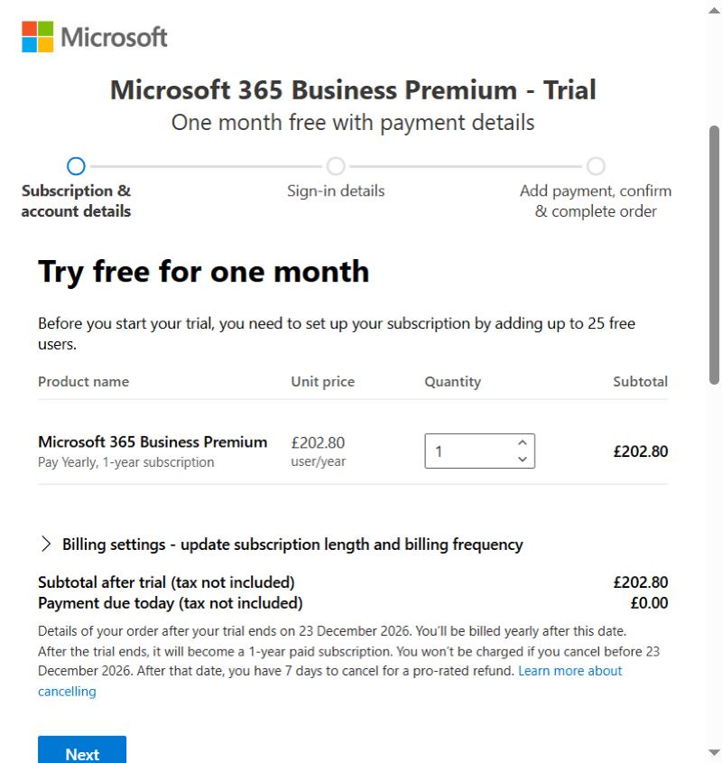
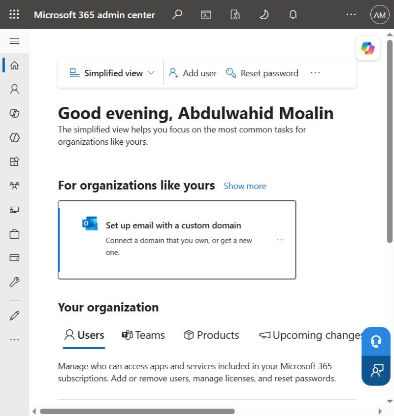

## Creating users

Each user was created in **Microsoft 365 admin center → Users → Active users → Add a user**:

1. **Basics:** first name, last name, display name, username. Auto-generated password with *"Require this user to change their password when they first sign in"* enabled.
2. **Licence:** Microsoft 365 Business Premium (gives the user a mailbox, Office apps and Intune).
3. **Profile info:** job title and department, so users can be grouped and filtered later.
4. **Review and finish.**

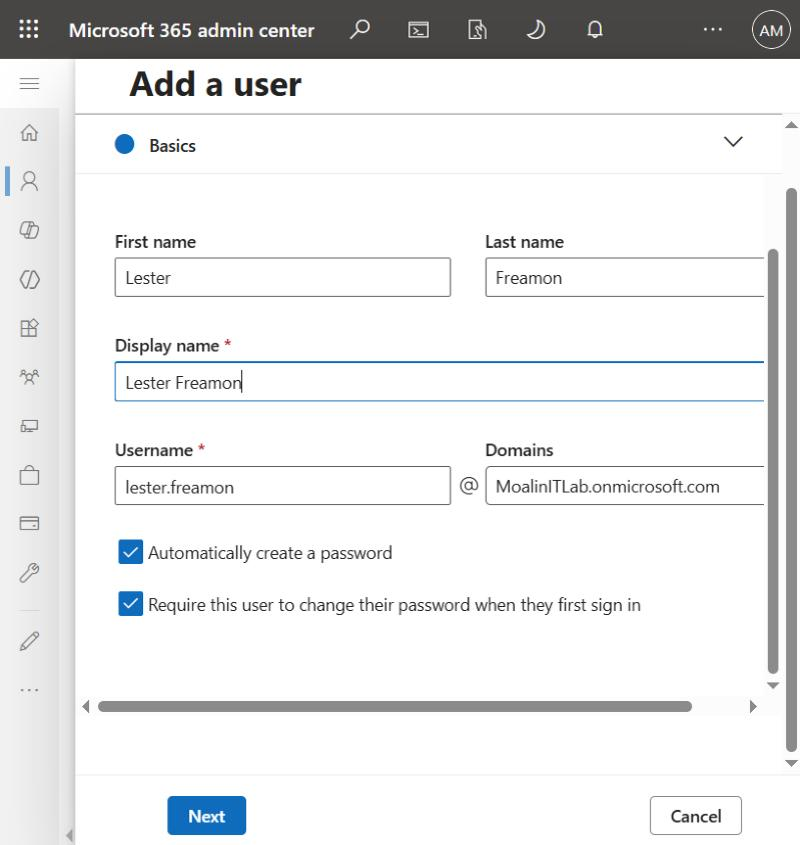
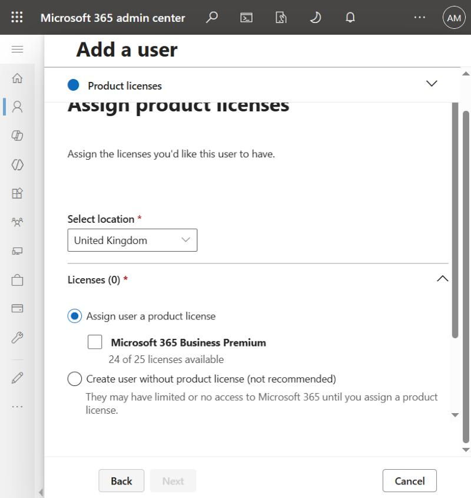
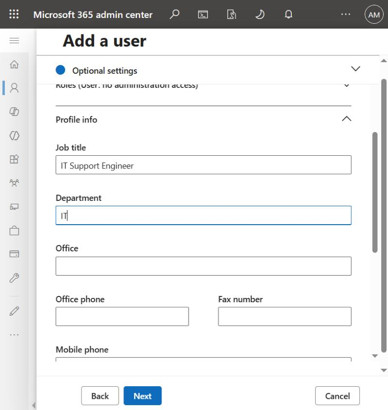
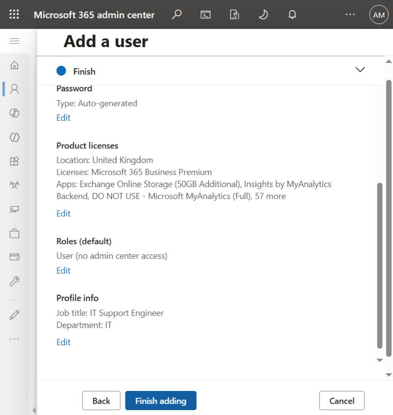

Result: four licensed users plus the admin account.

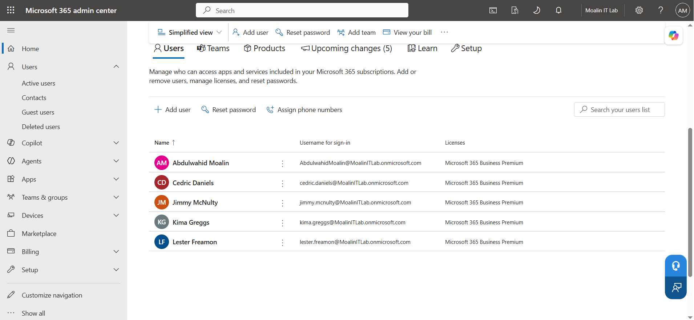

*Bunk Moreland is deliberately not created in Microsoft 365 yet. He is the new starter in scenario 09.*

## ServiceNow instance

- Personal developer instance (PDI)
- The same five users created as ServiceNow users so they can be callers on tickets
- Assignment group **Moalin Service Desk**, with all lab tickets assigned to it
- The instance's built-in demo tickets are kept but filtered out of the lab views

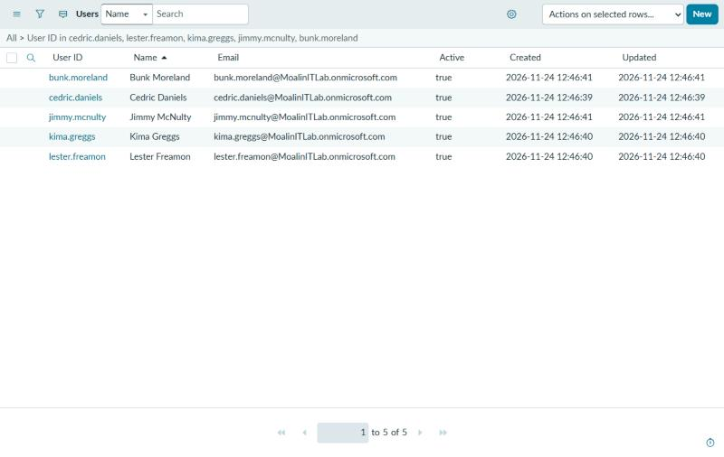
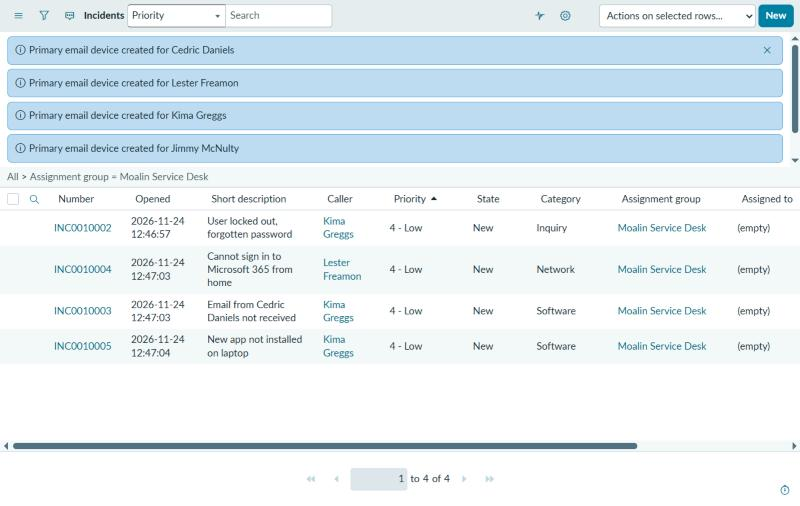
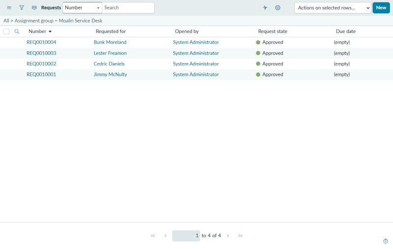

## Incidents vs requests

- **Incident:** something is broken (a password lockout, email not arriving). Logged as `INC` tickets.
- **Request:** the user needs something (access, a new starter, a leaver). Logged as `REQ` tickets.

Requests follow ServiceNow's three-level structure:

| Level | Record | Purpose |
|---|---|---|
| Request | `REQ` | The user's order, like a shopping basket |
| Requested item | `RITM` | What was ordered, e.g. "offboard Jimmy McNulty" |
| Catalog task | `SCTASK` | The actual work, assigned to a team and worked by an analyst |

The service desk works and closes the **SCTASK**. Once all tasks are complete, the RITM and REQ close.

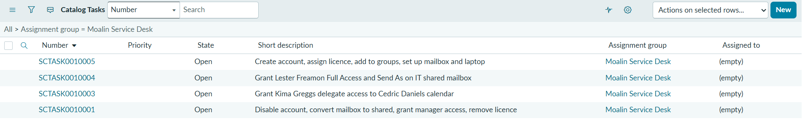
