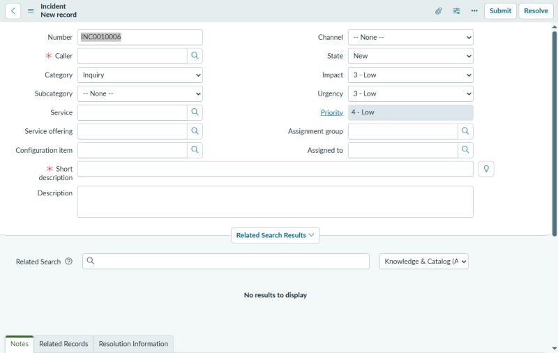
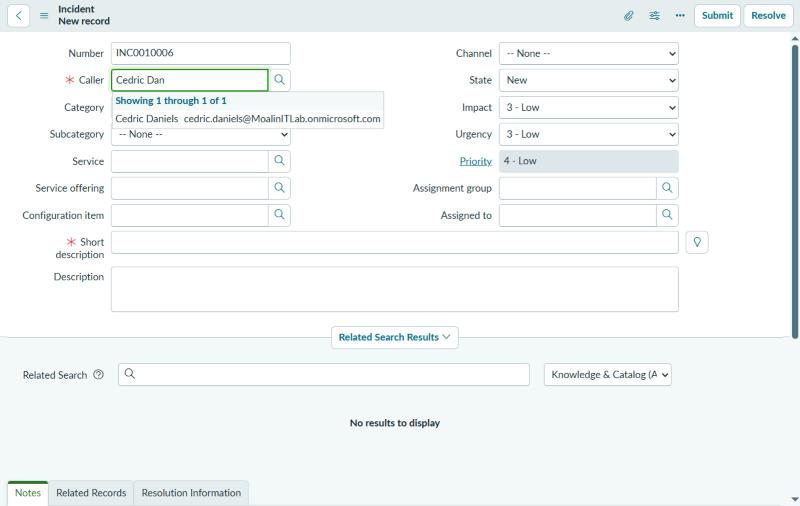
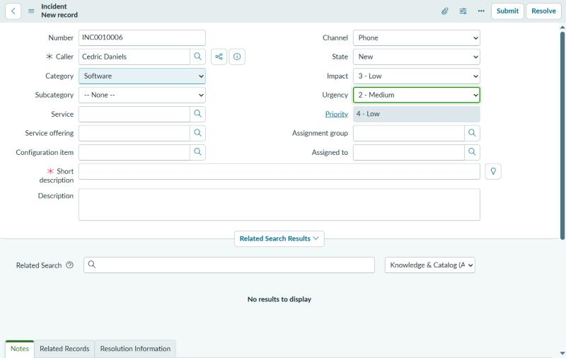
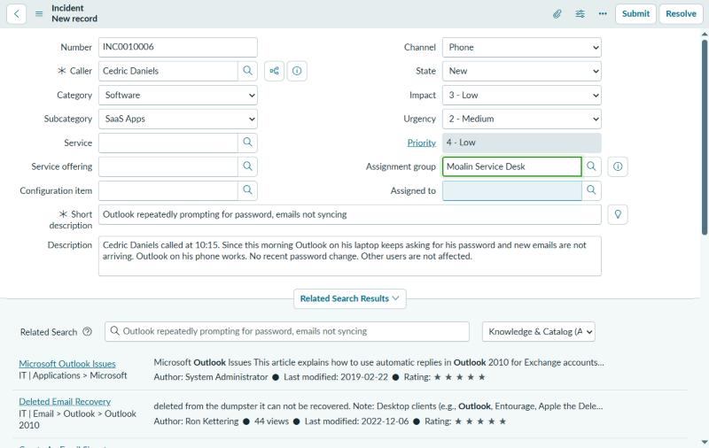

# ITSM notes

Reference notes from working tickets in ServiceNow.

## Logging a call

When a user phones in, log the ticket while they talk:

1. **New incident** (Incident → Create New). ServiceNow assigns the number straight away.
2. **Caller:** pick the person from the dropdown, not free text, so the ticket links to their account and history.
3. **Channel:** Phone, Email, Self-service, Walk-in…
4. **Category / subcategory:** what kind of problem it is.
5. **Impact and urgency.** ServiceNow calculates the priority from these. Never set priority by hand.
6. **Short description:** one line saying what's wrong.
7. **Description:** facts gathered on the call: when it started, what still works, anything that changed, whether anyone else is affected.
8. **Check suggested knowledge articles** that appear under the form before troubleshooting from scratch.
9. **Assignment group**, then **Submit**.

## Priority = impact × urgency

- **Impact:** how many people or how much of the business is affected.
- **Urgency:** how quickly it needs fixing.
- One user who can't print → low impact. A whole site with no network → high impact, high urgency → P1.

## SLAs (this instance's built-in definitions)

| Priority | Response | Resolution |
|---|---|---|
| P1 – Critical | 15 minutes | 1 hour |
| P2 – High | 1 hour | 8 hours |
| P3 – Moderate | 4 hours | 1 day |
| P4 – Low | 8 hours | 2 days |

- Times count in **business hours**, not calendar hours.
- The **response** SLA stops when the ticket is picked up.
- The **resolution** SLA **pauses** on *On Hold* and *Resolved*, so always document why a ticket is on hold.
- **OLAs** are internal targets between IT teams (for example, the Network group resolution: 4 hours).
- Check them on any ticket under the **Task SLAs** related list.

## Work notes vs additional comments

| Field | Who sees it | Use for |
|---|---|---|
| Work notes | IT only | Troubleshooting steps, findings, internal handover |
| Additional comments | User and IT | Updates and questions to the user. Triggers an email notification |

## What good ticket notes include

- How the caller's identity was verified (essential for password and access tickets)
- The steps taken, in order, including what didn't work
- The tool or system used
- How the fix was confirmed with the user
- **Never** passwords, MFA codes or other sensitive data

## Assignment

You can only assign a ticket to someone who is a **member of its assignment group** and has the **`itil` role** (ServiceNow's role for IT agents who work tickets). Even an admin account won't appear in *Assigned to* without it.

Best practice is to grant the role **to the group, not the individual**: give the *Moalin Service Desk* group the `itil` role, and every member inherits it. Access then follows team membership, so joiners and leavers in the IT team need only a group change.
