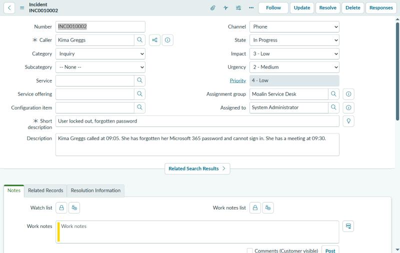
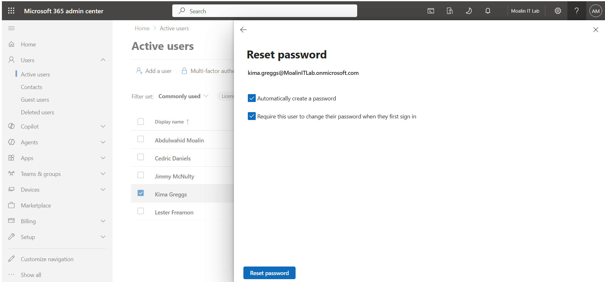
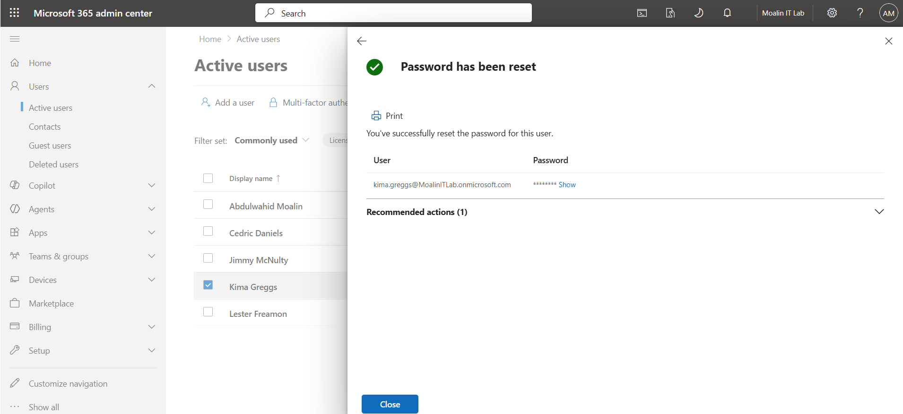
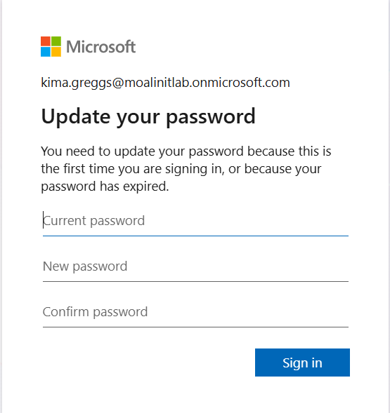
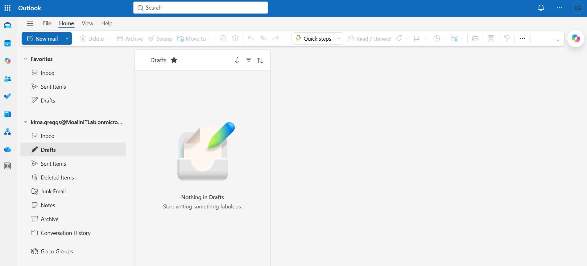
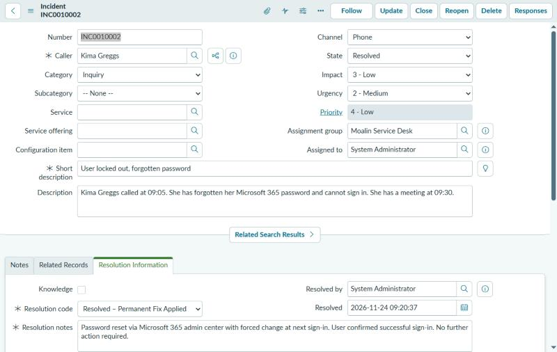

# 01 – Forgotten password (INC0010002)

## The call

> **Kima Greggs (Operations)** calls the service desk at 09:05. She has forgotten her Microsoft 365 password, can't sign in, and has a meeting at 09:30.

## The ticket

| Field | Value | Why |
|---|---|---|
| Channel | Phone | How the user contacted us |
| Category | Inquiry | |
| Impact | 3 – Low | Only one user affected |
| Urgency | 2 – Medium | She can't work and has a meeting soon |
| **Priority** | **4 – Low** | Calculated by ServiceNow from impact × urgency |
| SLA | Response 8h, resolution 2 business days | Priority 4 SLAs |
| Assignment group | Moalin Service Desk | |

## Steps

### 1. Pick up and assign the ticket
Assigned the incident to myself and set the state to **In Progress**. Verified the caller's identity before making any change: full name and department checked against Entra ID.

### 2. Reset the password in Microsoft 365
**Admin center → Active users → Kima Greggs → Reset password**

- ✅ **Automatically create a password:** a strong random password, not one made up by IT
- ✅ **Require this user to change their password when they first sign in:** only the user ends up knowing her real password
- ❌ Did **not** email the password, because her mailbox is exactly what she can't get into, and emailing passwords is poor practice

The temporary password was given to the user **verbally over the phone** and was not recorded in the ticket or in screenshots.

### 3. Confirm the user can sign in
Tested in a private browser window as the user. On first sign-in Microsoft forced a password change, which proves the *"require change"* option worked. After setting a new password, the user reached her mailbox in Outlook on the web.

### 4. Document and resolve

**Work notes (internal):**
> Called user back. Identity verified by confirming full name and department (Operations) against Entra ID. Reset password in Microsoft 365 admin center: auto-generated temporary password, "require change at next sign-in" enabled. Temporary password provided verbally, not recorded in ticket. User signed in successfully, set a new password and confirmed access to her mailbox.

**Additional comments (customer visible):**
> Hi Kima, as discussed on the phone, your password has been reset. If you have any further issues signing in, please contact the service desk.

**Resolution notes:**
> Password reset via Microsoft 365 admin center with forced change at next sign-in. User confirmed successful sign-in. No further action required.

State set to **Resolved** with resolution code *Resolved – Permanent Fix Applied*. The response SLA was met when the ticket was assigned. The resolution SLA pauses on Resolved while the ticket waits to auto-close.

## Key decisions

- **Verify identity first.** A password reset for the wrong person is a security incident.
- **Never record passwords** in tickets, screenshots or email.
- **Additional comments still matter** even though the user can't read email while locked out. She sees the notification once signed in, and it is the record of what the user was told.

## Prevention

**Self-service password reset (SSPR)**, an Entra ID P1 feature, would let users like Kima reset their own password at `aka.ms/sspr`, cutting down on calls like this one. *Planned as a follow-up lab.*

## Interview takeaway

> "I reset it with an auto-generated temporary password and forced a change at next sign-in, gave it to the user verbally after verifying her identity, never recorded it in the ticket, and documented each step in ServiceNow."
