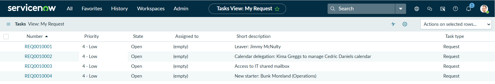
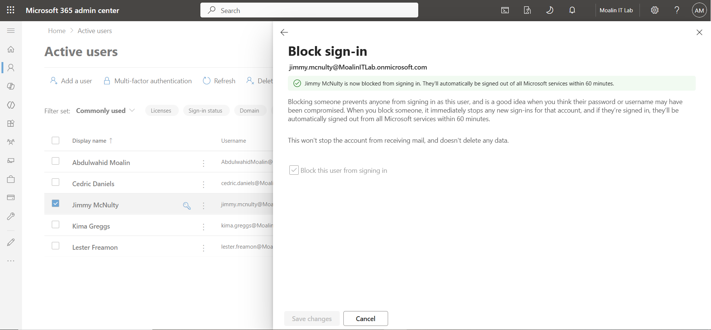
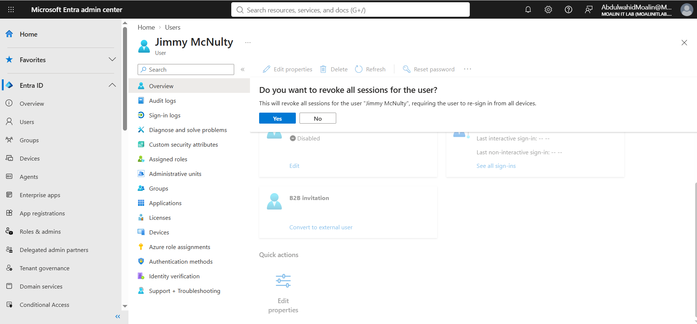
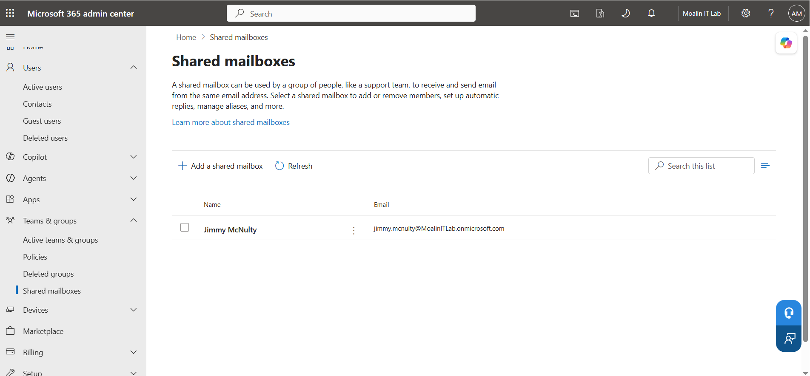
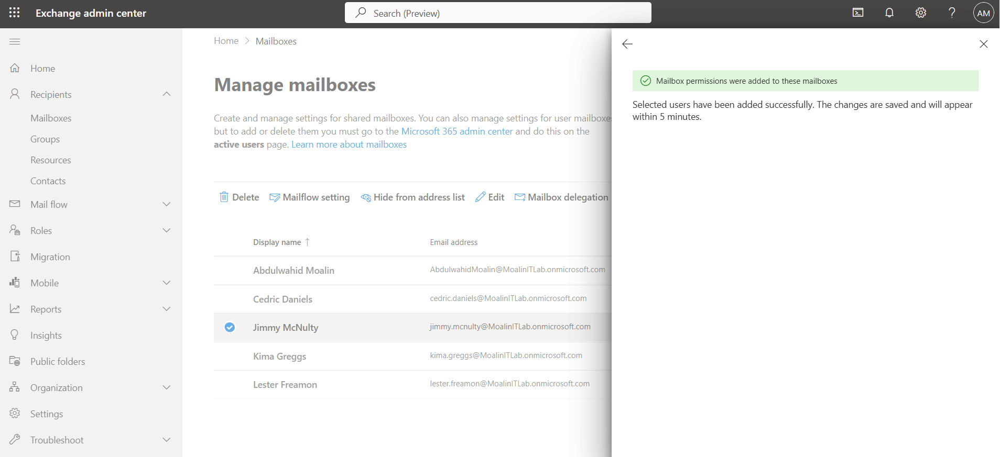
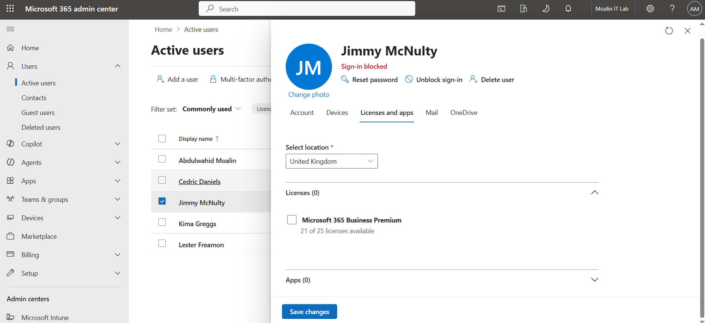
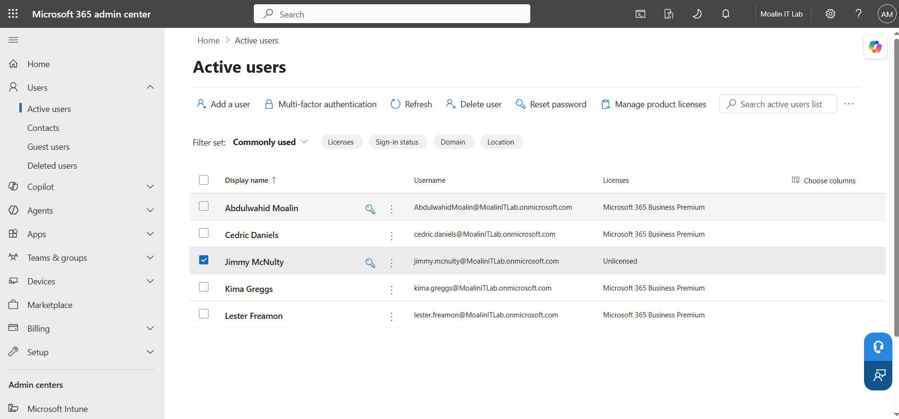
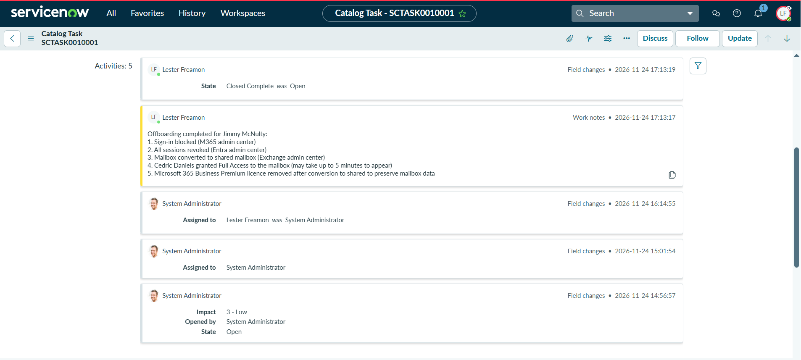

# 06 – Leaver: Jimmy McNulty (REQ0010001)

## The request

> **Cedric Daniels (Operations Manager)** reports that **Jimmy McNulty** leaves today. His access must be removed, but his email must be kept and handed over to Cedric.

## The ticket

| Level | Record | Purpose |
|---|---|---|
| Request | REQ0010001 | Leaver: Jimmy McNulty |
| Requested item | RITM0010001 | Offboard Jimmy McNulty |
| Catalog task | **SCTASK0010001** | Disable account, convert mailbox to shared, grant manager access, remove licence |

Worked by **Lester Freamon** (Moalin Service Desk) in the ServiceNow **Service Operations Workspace**.

## Steps

### 1. Block sign-in (Microsoft 365 admin center)
**Active users → Jimmy McNulty → Block sign-in.** This stops any new sign-ins immediately.

Note from Microsoft: blocking *"won't stop the account from receiving mail"*, which is why the mailbox is handled separately in step 3.

### 2. Revoke all sessions (Entra admin center)
Blocking stops new sign-ins, but devices that are **already signed in** can stay connected for up to 60 minutes. Revoking sessions forces them out now.

Once a user is blocked, the M365 admin center hides its *"Sign out of all sessions"* option, so this was done in **Entra admin center → Users → Jimmy McNulty → Revoke sessions**. The Entra overview also shows the account as **Disabled**, the same setting viewed from the identity console.

### 3. Convert the mailbox to a shared mailbox (Exchange admin center)
**Recipients → Mailboxes → Jimmy McNulty → Others → Convert to shared mailbox.** His existing emails are kept, mail sent to his address still arrives, and a shared mailbox needs no licence.

### 4. Give the manager access
**Mailbox → Delegation → Read and manage (Full Access) → Cedric Daniels.** Changes can take up to 5 minutes, sometimes longer, to appear in Cedric's Outlook. Worth telling the requester, so it doesn't become a "can't see the mailbox" ticket.

### 5. Remove the licence
**Licenses and apps → untick Microsoft 365 Business Premium → Save changes.**

**The order matters.** A *user* mailbox needs a licence. If the licence is removed first, the mailbox is deleted after 30 days, along with all its email. Converting to shared **first** makes the mailbox licence-free, so the licence can then be removed safely and the company stops paying for it.

### 6. Document and close
All steps were recorded in a work note, and the task was closed as **Closed Complete**. With its only task complete, the RITM and REQ close too.

## Which console does what

| Step | Console | Why there |
|---|---|---|
| Block sign-in | M365 admin center | Everyday user management |
| Revoke sessions | Entra admin center | Identity and security; still available after the user is blocked |
| Convert mailbox, Full Access | Exchange admin center | Entra manages identities, not mailboxes |
| Remove licence | M365 admin center | Licensing and billing |

## In a real company, a full offboarding would also include
- **Removing MFA methods** (Entra → Authentication methods)
- **Removing the user from groups** and distribution lists
- **Giving the manager access to OneDrive** files
- **An automatic reply** on the mailbox ("Jimmy has left, please contact Cedric")
- **Wiping or retiring devices** in Intune and collecting hardware
- **Hybrid environments:** disabling the account in **on-premises Active Directory**, which syncs to Entra ID
- Deleting the account after the company's **retention period**

## Interview takeaway

> "For a leaver I block sign-in and revoke sessions, convert the mailbox to shared and give the manager Full Access, then remove the licence. Converting first matters, because a user mailbox without a licence is deleted after 30 days, while a shared mailbox doesn't need one."
